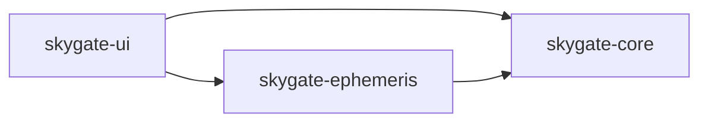

# Overview

Skygate is an in-process Qt 6 desktop application that renders an interactive
sky view. The codebase has three CMake modules with one-way dependency
direction:

- `apps/skygate-ui`: Qt Quick application shell, QML views, presentation
  state, catalog download and import, persistence, and scene-graph rendering.
- `libs/skygate-ephemeris`: star catalog loading and parsing, identity-based
  composition, catalog normalization, constellation data, astronomical
  coordinate calculation, and snapshot generation.
- `libs/skygate-core`: UI-independent domain types, projection contracts and
  implementations, viewport math, and time abstractions.

`skygate-core` is the lowest-level reusable library. `skygate-ephemeris`
builds on it. `skygate-ui` composes both and owns the Qt-specific behavior.

## Runtime flow

### Startup

`apps/skygate-ui/src/main.cpp` configures logging, loads bundled ephemeris
data metadata when present, registers the QML/C++ types, and wires the UI
object graph:

1. `SkyContextController` owns the mutable application state exposed to QML.
2. `SkyCatalogManager` owns the configured catalog source collection and
   delegates active composition to `SkyCatalogRuntime`.
   `SkyEphemerisDataManager` owns bundled and installed high-precision data
   state.
3. `SkyContextController` attempts to recreate the selected ephemeris engine
   from the current catalog, engine settings, and active ephemeris data. If a
   data refresh would only produce a simple fallback while a high-precision
   engine is already active, the controller keeps the active high-precision
   engine. Time-scale, Earth-orientation, and kernel providers derived from
   the active data set are cached across engine rebuilds and invalidated
   when the data set changes. The cached kernel provider skips per-open
   checksum verification because installed data is checksum-verified on
   activation.
4. `SkySceneModel` listens to the controller and derives renderable scene
   data.
5. `SkyViewportItem` consumes the scene model and renders the sky with
   Qt Quick scene graph nodes.
6. QML overlays and toolbars provide interaction, labels, preferences, and
   status surfaces around the custom viewport.

### Frame production

1. User input, timer ticks, settings restore, location updates, or catalog
   changes mutate `SkyContextController`.
2. The controller emits `skyContextChanged()`.
3. `SkySceneModel` decides whether it must recompute an ephemeris snapshot,
   rebuild projected render data, or both.
4. `SkyRenderFrameBuilder` converts snapshot data into render points, lines,
   symbolic deep-sky glyphs, and overlay labels.
5. `SkyViewportItem` copies the derived frame into render data and rebuilds
   batched `QSGNode` geometry.
6. QML overlay components render hover labels and scene annotations on top
   of the viewport.

## Common patterns

The codebase reuses a small set of patterns:

- Layered modules: `skygate-ui` for application and presentation concerns,
  `skygate-ephemeris` for astronomy and data, `skygate-core` for reusable
  domain and math concerns.
- Strategy plus factory: `IProjection` with `createProjection(...)`,
  `IEphemerisEngine` with `EphemerisEngineFactory`, `IStarCatalog` with the
  catalog construction helpers.
- Read model: `SkySceneModel` derives render data from controller state and
  caches the results instead of mixing rendering logic into the controller.
- Coordinator plus services: `SkyCatalogManager` owns the configured source
  collection and its lifecycle, `SkyCatalogRuntime` owns the active composed
  state, `CatalogCoordinator` orchestrates operations, and download and
  parsing sit in focused services.
- Immutable snapshots: `EphemerisSnapshot` shares immutable catalog bodies
  and stores per-frame state separately.
- Builder and pipeline: `SkyRenderFrameBuilder` turns snapshots into render
  primitives; catalog parsing flows through container decoding, schema
  detection, parser selection, normalization, and catalog construction;
  composition flows through identity resolution and the shared merge policy.
- Cache-oriented view model: cache keys are explicit and local to
  `SkySceneModel`; revision counters invalidate derived work when catalog
  data changes.
